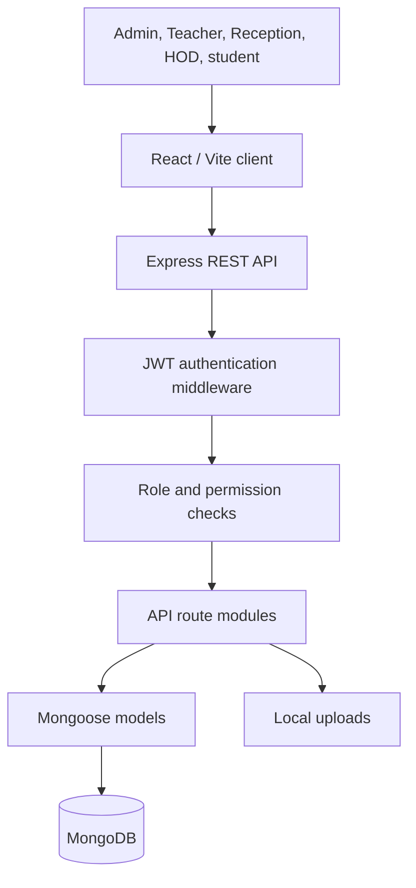

# Student ERP Architecture

## System context

The Student ERP is a split frontend/backend application. A React/Vite client calls an Express API, which authenticates requests and reads or writes MongoDB through Mongoose models.

## Backend domains

- Authentication and user roles
- Students, departments, courses, and enrollments
- Attendance and student portal
- Results, exams, halls, and seat assignments
- Fees, fines, and service ledgers
- Academic terms, prerequisites, and degree requirements
- Activity logs, compliance, and notifications

## Repository layout

- `backend/config/`: database configuration
- `backend/middleware/`: authentication, request logging, and activity logging
- `backend/models/`: Mongoose schemas
- `backend/routes/`: REST endpoints
- `backend/scripts/`: development seed data
- `frontend/src/`: React application, pages, components, contexts, and utilities

## Local development

Install dependencies from the root, backend, and frontend package manifests using `npm run install:all`. Configure `backend/.env` from `backend/.env.example`, then run `npm run dev` from the repository root.

## Security and operations

- Use a unique high-entropy JWT secret in each environment.
- Keep MongoDB credentials and environment files out of Git.
- Replace or disable seed/demo accounts before any public deployment.
- Validate role authorization on every protected API route.
- Treat uploaded files as untrusted input and enforce size/type limits.
- Back up MongoDB and test restoration.
- Keep dependency directories and build output out of version control.
